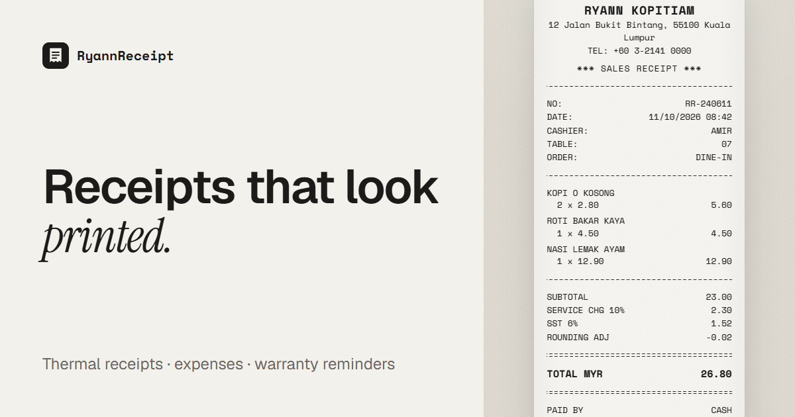

# RyannReceipt

**Track spending fast, and print a retro receipt any time.**
A local-first expense tracker that also turns any purchase into a printed-style thermal receipt.
Works without an account; sign in with Google to back up and sync across devices.

**Live:** https://ryannreceipt.ryannsuite.workers.dev/ · Part of [RyannSuite](https://ryannsuite.pages.dev)



## Highlights

- **Quick add** understands a whole note like `nasi lemak 12.90 tng yesterday #work`.
- **Scan a receipt** with on-device OCR (Tesseract.js); photos aren't uploaded unless you keep them.
- **Split bills** per dish, with service charge and tax shared pro rata, and send the breakdown on WhatsApp.
- Budgets, warranties, recurring bills, travel mode with currency conversion, CSV import and PDF reports.
- English, 中文 and Bahasa Melayu. Installable, and works offline.

## How it's built

| Layer | Tech |
|---|---|
| App | Next.js 16 (App Router), React 19, TypeScript, Zustand, Zod |
| API | Route handlers in `app/api` as a backend-for-frontend |
| Data & auth | Supabase (Postgres with row-level security, Storage), Google Identity Services |
| Other | Tesseract.js (OCR), jsPDF, service worker for offline |
| Hosting | Cloudflare Workers via OpenNext, within the free plan's 3 MiB limit |
| Quality | Vitest, Playwright with an axe accessibility scan, GitHub Actions CI |

**Engineering notes:**
- **Local-first.** Data lives in the browser first, and cloud sync is opt-in.
- **Guarded writes.** Every write passes same-origin checks, rate limits and Zod validation; totals are recomputed on the server; row-level security is the final boundary.
- **Shareable links can't be guessed.** They're served through a security-definer function, so links can't be listed.
- **Type-checked translations.** The translation dictionaries are type-checked, so no key goes missing.

See [Architecture](#architecture) below for the details.

---

Developer notes follow.

## Setup

```bash
npm install
cp .env.example .env.local   # fill in the Supabase keys
npm run dev
```

Run every SQL file in `supabase/migrations/` (in order) in the Supabase SQL editor.
They only create `receipt_*` objects and are safe to re-run.

## Scripts

| Command | What it does |
|---|---|
| `npm run dev` | Dev server |
| `npm run typecheck` / `npm run lint` | TypeScript and ESLint |
| `npm test` | Unit tests (Vitest) |
| `npm run test:e2e` | Browser tests incl. an axe accessibility scan (Playwright, installed Edge) on :3100 |
| `npm run cf:build` / `npm run cf:size` | Build for Cloudflare / check the Worker fits the free plan (3 MiB gzipped) |
| `npm run cf:preview` | Build for Cloudflare and run locally in workerd |
| `npm run cf:deploy` | Build, check size, deploy to Cloudflare Workers |

GitHub Actions (`.github/workflows/ci.yml`) runs typecheck, lint, unit and e2e tests and the
bundle-size check on every push to `main` and on pull requests.

## Deploying to Cloudflare

**From GitHub (recommended).** Cloudflare dashboard → Workers & Pages → Create → Import a repository:

- Build command: `npx opennextjs-cloudflare build`
- Deploy command: `npx opennextjs-cloudflare deploy`
- Settings → Build → **Variables**: `NEXT_PUBLIC_SUPABASE_URL`, `NEXT_PUBLIC_SUPABASE_ANON_KEY`,
  `NEXT_PUBLIC_GOOGLE_CLIENT_ID`, `NEXT_PUBLIC_SITE_URL` (they are inlined at build time; `.env.local`
  is never committed).

Every push to `main` then deploys. **From this machine:** `npx wrangler login`, then `npm run cf:deploy`
(uses `.env.local`).

After the first deploy, add the site URL to the Google OAuth client's **Authorized JavaScript origins**.

Rate limiting uses Cloudflare's Rate Limiting bindings (`RL_AUTH`, `RL_WRITE`,
`RL_READ` in `wrangler.jsonc`) on top of an in-memory window.

## Using it

- **Home** (`/history`, where the installed app opens): this month, today, a big **Add an expense**,
  then your expenses grouped by day. Charts, calendar and breakdowns sit under **Insights**
  (folded on phones). Returning visitors skip the landing page.
- **Add expense** (Alt+Q, or the **+** on phones): amount first, then what it was for (it still
  understands a whole note like `nasi lemak 12.90 tng yesterday #work`), categories you use most
  first, and payment / wallet / date under "Paid with".
- **Tap an expense** to edit it in the same simple sheet (amount, what for, category, paid with), with
  Split, Delete and "Open as receipt"; itemised receipts keep their amount.
- **Income**: the add sheet has Expense | Income. Monthly income (salary) counts every month until
  stopped; Home then shows **Left to spend** and the share kept.
- **Repeating bills**: a shop paid once a month two months running is offered as a recurring expense.
- **First visit**: a 2-step setup (currency, optional budget) clears the demo receipt.
- **Receipt maker** (`/studio`): each step shows only the essentials; everything else is under
  "More options". Any expense opens here to become a printed-style receipt.
- **Templates**: first visit opens a gallery (Kopitiam, Grocery, Electronics, Ride, Hawker, Blank); later via **New ▾**.
- **Four steps**: Shop → Items → Payment → Look. Click any line on the paper to jump to its field.
- **Looks**: one-click paper/typeface/grain combinations; finer control under *More options*.
- **Shortcuts**: Ctrl/⌘+Z undo, Ctrl/⌘+Shift+Z redo, Ctrl/⌘+S export PNG, Ctrl/⌘+P print, Alt+N new, `?` help.
- **Languages**: English, 中文, Bahasa Melayu (Settings ⚙). Light/dark/system theme in the same menu.
- **History**: today / month tiles, daily-spending calendar, breakdown by category / wallet / tag
  with budgets, warranty tracker, tax relief (LHDN) summary, recurring expenses, CSV and PDF reports.
- **Quick add** (Alt+Q): one line like `nasi lemak 12.90 tng yesterday #work`; one-tap "add again".
- **Scan receipt**: photo → receipt with on-device OCR (Tesseract.js, free; nothing uploaded unless
  you keep the photo). On phones, share a photo to the installed app to scan it.
- **Smart auto-fill**: shop names suggest past visits and fill address, category, wallet and tax;
  item names suggest last prices.
- **Reminders** (bell): warranties ending, budget at 80%+, recurring payments due, evening nudge.
- **Split bill**: tap who had each dish; service charge, tax and discounts are shared pro rata and the
  payer absorbs rounding. Mark who has paid back, send the breakdown on WhatsApp (with your DuitNow /
  bank details from Settings → Payment details). History counts only your share; the Friends card shows
  who owes whom.
- **Travel mode**: pick a home currency in History; foreign receipts are converted at the latest ECB
  rates (Frankfurter, free, proxied via `/api/fx`).
- **App lock** (Settings → App lock): PIN, optionally fingerprint / face (WebAuthn). A privacy screen
  for this device, not encryption.
- **Share link** (signed in): a view-only `/r/<token>` page without split, wallet, tags or photo;
  revocable any time.
- **Import CSV**: bank / e-wallet statements, parsed on the device. Only money out is imported and
  re-importing the same file never duplicates.
- **Year review**: a receipt-style summary of the year, shareable as an image.
- **Backup & restore** (Settings): download everything as a JSON file and restore it on any device.
  Signed-out users get a reminder every 30 days. The app-lock PIN is never included.
- **On phones**: a bottom tab bar with a big **+** (Quick add, Scan, New receipt, Import CSV); swipe a
  receipt right to split it, left to delete it (with Undo).
- **History** groups receipts by day with daily totals, shows one spending insight (vs the same days
  last month, or your logging streak), and folds tools you haven't used yet into **More tools**.
- **Privacy & Terms**: `/privacy` and `/terms`, linked from the home page footer.

## Architecture

- **Local-first.** Receipts live in a Zustand store persisted to localStorage
  (`lib/store/receipt-store.ts`). Guests never need an account.
- **Cloud sync.** Signed-in users autosave the open receipt; after sign-in, local
  drafts can be synced in one go. The local uuid is the cloud row id.
- **Auth.** Google Identity Services → `POST /api/auth/google/token` with a
  server-issued nonce → Supabase `signInWithIdToken`. Session cookies are httpOnly.
- **BFF.** `/api/receipts`, `/api/receipts/[id]`, `/api/presets`, `/api/account`:
  same-origin check on writes, rate limits, Zod validation, totals recomputed
  server-side, RLS as the final boundary.
- **Synced settings** (budgets, recurring rules, friends, payment details, home currency) live in `receipt_settings`; receipt photos in the
  private `receipt-photos` Storage bucket (`<user id>/<receipt id>.jpg`), both behind RLS.
- **Account data deletion** removes RyannReceipt rows, settings and photos only. The Supabase auth user
  is shared with RyannPace/RyannPlan and is never deleted from here.
- **Share links** live in `receipt_shares` (owner-only RLS); the public page reads one row through the
  `get_receipt_share(token)` security-definer function, so links can't be listed or guessed.
- **Offline.** `public/sw.js` caches the app shell and static assets; `/api` is never cached.
- **i18n.** `lib/i18n/{en,zh,ms}.ts`; English is the source of truth and the other
  dictionaries are type-checked for missing keys. Printed receipt labels stay English.

---

Built by [Bernard Ryan Sim](https://ryannsuite.pages.dev). © Bernard Ryan Sim. All rights reserved.
